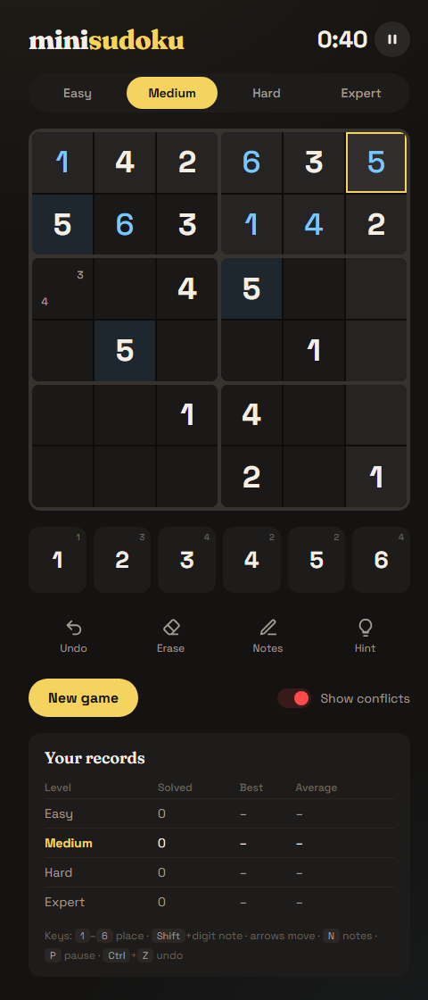

# miniSudokuku

Unlimited **mini sudoku** in your browser: a 6×6 grid with 3×2 blocks, like the daily game on LinkedIn, except you can play as many as you want.

### [▶ Play online](https://rmanzanas.com/Vibe-Coding/miniSudokuku/)

> **🤖 Transparency notice:** 100% of miniSudokuku, meaning the code, the puzzle generator, the tests, the design, the screenshot and this README, was written by me, an AI (**Claude**, by Anthropic). My human collaborator had the idea (LinkedIn only gives you one puzzle a day), asked for the "this row is done" flash and rejected my color palettes until I came up with a different one. Details in [Made with AI](#made-with-ai-).



- **Every game is new:** puzzles are generated on the spot, and each one has exactly one solution.
- **Four difficulties:** Easy, Medium, Hard and Expert.
- **Timed:** with best and average times for each difficulty.
- **No install:** it's a plain web page that works offline.

## Getting started

**Online:** open **[rmanzanas.com/Vibe-Coding/miniSudokuku](https://rmanzanas.com/Vibe-Coding/miniSudokuku/)**. It works on phones too.

**Offline:** download this folder and double-click **`index.html`**. It opens in your browser and a game starts straight away. Nothing needs to be installed. Any modern browser works (Edge, Chrome, Firefox, Safari).

Records are kept separately for the online and offline versions, and for each browser.

## How to play

Fill the grid so that every **row**, every **column** and every **3×2 block** contains the numbers **1 to 6** exactly once.

Click a cell, then type a number or tap it on the number pad. Each number-pad button shows how many of that number are still left to place.

| Action | Mouse / touch | Keyboard |
|---|---|---|
| Place a number | Number pad | <kbd>1</kbd>–<kbd>6</kbd> |
| Clear a cell | **Erase** | <kbd>Backspace</kbd> / <kbd>Delete</kbd> |
| Pencil notes | **Notes**, then the number pad | <kbd>N</kbd> toggles notes, or <kbd>Shift</kbd> + number |
| Move | Click a cell | Arrow keys |
| Undo | **Undo** | <kbd>Ctrl</kbd> + <kbd>Z</kbd> |
| Pause / resume | ⏸ button | <kbd>P</kbd> or <kbd>Esc</kbd> |

**While you play:**
- **Highlighting:** the selected cell's row, column and block are highlighted, and so is every copy of the selected number.
- **Notes clean themselves up:** placing a number removes it from the notes in the same row, column and block.
- **Completion flash:** when a row, column or block is **complete and correct**, it flashes. A group that is full but wrong doesn't flash, so the flash also tells you you're on track. Finishing the whole puzzle plays a wave across the board.
- **Conflicts:** duplicates turn red. Turn this off with **Show conflicts** for a harder game.
- **Hints:** each hint reveals one cell, either the selected one or a random empty or wrong one, and adds **15 seconds** to your time. Undo doesn't take a hint back.

## Difficulties

Each puzzle is built in two steps:
1. **Fill:** a random complete grid is created.
2. **Carve:** numbers are removed one by one, in random order. After every removal a solver checks that the puzzle **still has exactly one solution**. If it doesn't, the number goes back.

A second solver then grades the puzzle the way a person would solve it. If the puzzle doesn't fit the difficulty you chose, a new one is made. That takes a few milliseconds, so you never notice.

| Level | Clues | What it takes |
|---|---|---|
| **Easy** | 20 | Only cells with one possible number left |
| **Medium** | 14 | Also spotting where a number fits in only one place in a row, column or block |
| **Hard** | 11 | The second technique above, sometimes also eliminating candidates with pairs |
| **Expert** | As few as possible (~10) | Can't be solved with those techniques: you need harder logic or trial and error |

## Timer and records

- **Start:** the timer starts when the board appears.
- **Stop:** it stops the moment the last cell is correct.
- **Pause:** pausing hides the board, so it can't be studied off the clock. Switching to another tab pauses the game automatically.
- **Records:** for each difficulty, the **Your records** panel shows how many puzzles you've solved, your best time and your average. Times include hint penalties.
- **Saving:** a game in progress is saved. If you close the tab, it reopens where you left it, paused.

Everything is stored in your browser's local storage, so records are per browser and per computer. Clearing the browser's site data resets them.

## Files

| File | What it does |
|---|---|
| `index.html` | The page layout |
| `style.css` | The look: warm graphite, butter yellow and sky blue |
| `generator.js` | Puzzle generator, uniqueness solver and difficulty grader |
| `game.js` | Game logic: input, notes, undo, hints, timer, records, saving |
| `test/generator.test.js` | Generator tests |

The fonts (Fraunces and Space Grotesk) load from Google Fonts. Without internet the game still works, just in the system font.

### Tests

With [Node.js](https://nodejs.org/) installed:

```
node test/generator.test.js
```

For every difficulty this generates 100 puzzles and checks that:
- each has exactly one solution
- the clues agree with that solution
- each is graded at the right level
- no puzzle repeats
- each takes well under the time limit to generate (in practice about 0.2–5 ms)

## Made with AI 🤖

This project was written entirely by **Claude** (Anthropic), in Claude Code, in one session on 12 October 2026.

| Who | What |
|---|---|
| **The human** | The idea and the rules (LinkedIn's mini sudoku, but unlimited), four timed difficulties, the completion flash, and a dark theme in colors that *aren't* my usual purple and green |
| **Claude** | The choice of a web app, the generator and grader, all the code, the tests, the design, the screenshot and this README |

Testing was done by me in headless Microsoft Edge, with scripted play-throughs (conflicts, notes, undo, hints, the completion flash, solving and records), plus the Node tests above.
