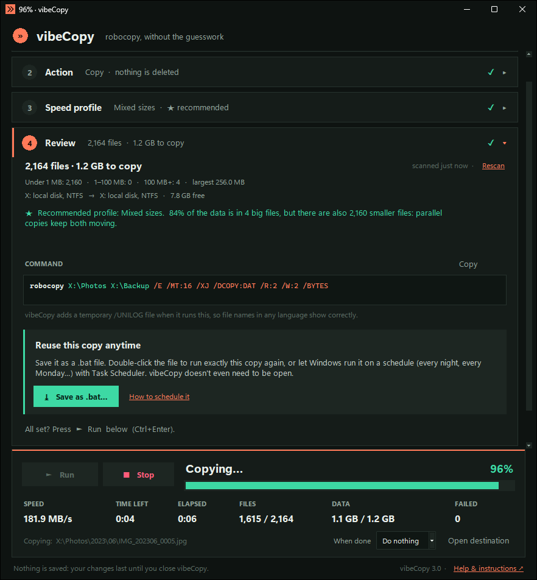
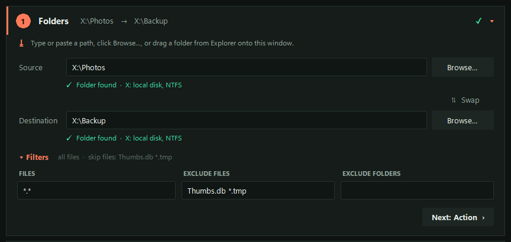
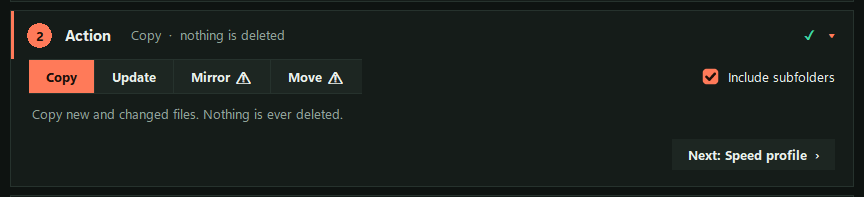
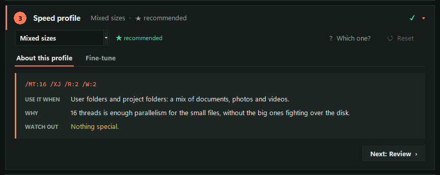
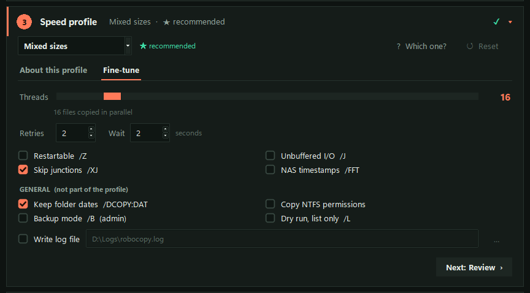
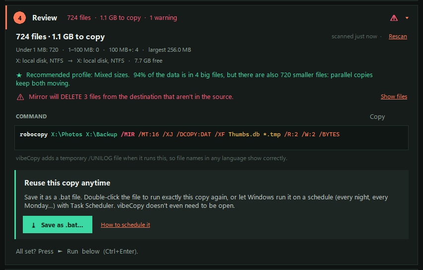
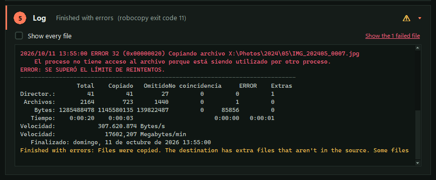
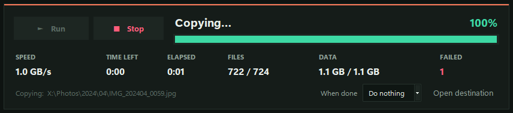
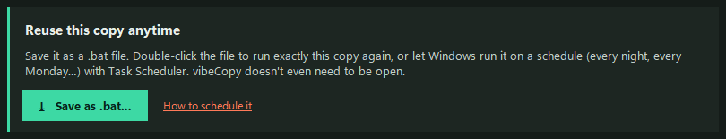
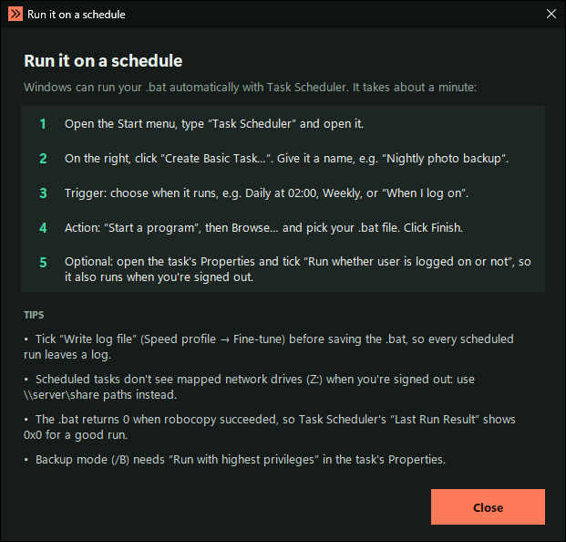

# vibeCopy

A dark-mode GUI for **robocopy**, the fast file-copy tool built into Windows.

> **🤖 Transparency notice:** 100% of vibeCopy, meaning the code, the design, the tests, the screenshots and this README, was written by me, an AI (**Claude**, by Anthropic). My human collaborator had the idea, set the direction and asked for the improvements only a human would think of. I did all the testing, on his PC. Details in [Made with AI](#made-with-ai-).

Robocopy copies much faster than Explorer, especially with lots of files, but it has dozens of cryptic options. With vibeCopy you drop in your folders and vibeCopy scans them. It then picks the best settings for your files and your drives, shows you the exact command, runs it, and tracks progress, speed and time left. **The copy itself is as fast as plain robocopy** (see [Speed first](#speed-first)).



## Requirements

- Windows 10 or 11 (robocopy is included with Windows)
- [Python 3.8 or newer](https://www.python.org/downloads/) (developed and tested on 3.11). Nothing else needs to be installed.

## Highlights

- **Fast:** the copy runs at plain-robocopy speed. Progress and ETA cost nothing measurable ([Speed first](#speed-first)).
- **Smart:** one scan picks the right settings for your files and drives ([Step 3](#3--speed-profile-how-to-copy-fast)).
- **Safe:** it warns you before anything is deleted, and shows exactly which files ([Step 4](#4--review-check-before-you-copy)).
- **Reusable:** save any copy as a **.bat file** and run it again with a double-click, or every night on a schedule ([Save as .bat](#save-as-bat-reuse-and-schedule-a-copy)).

Double-click **`vibeCopy.pyw`** to start it. It opens without a console window. The whole app is that one file. It doesn't create a settings folder or save anything: your changes last until you close it.

## How it works: five steps and a Run bar

The window is a single column of five steps. Click a step's header to open it (the others close), or use the **Next ›** button at the bottom of each step. A closed step still shows a one-line summary, plus a ✓ when it's fine or a ⚠ when something needs your attention. The **Run bar** is always visible at the bottom. The window also fits small laptop screens: the steps scroll, and the Run bar stays put.

### 1 · Folders: what to copy, and where to



Set the **Source** (copy *from*) and the **Destination** (copy *to*) in any of three ways:

- **Type or paste** a full path (`D:\Photos`, `\\nas\backup`). A relative path like `Photos` is refused, because it would silently point to wherever vibeCopy was started from. vibeCopy waits until you pause or press Enter before it scans, so it doesn't scan every half-typed folder.
- Click **Browse…**.
- **Drag a folder from Explorer** onto the window.

The line under each path tells you whether the folder was found (or *will be created*, for a new destination), and what kind of drive it's on: NVMe SSD, hard disk, USB drive, network drive… It turns red for mistakes, such as a destination inside the source. **⇅ Swap** exchanges the two paths.

**Filters** (click to unfold) limit what's copied:
- **Files:** which files to copy, e.g. `*.jpg *.png`. The default `*.*` means everything.
- **Exclude files** (`/XF`) and **Exclude folders** (`/XD`): names or wildcards to skip, e.g. `Thumbs.db *.tmp` or `node_modules .git`.

Separate entries with spaces, and use quotes for names that contain spaces. Entries can't start with `/`, because robocopy would read them as options. vibeCopy refuses them.

**Drag & drop rules:**
- Dropped on the Source or Destination row → it goes into that field.
- Dropped anywhere else → it fills the first empty field. If both are filled, vibeCopy asks which one.
- A **file** dropped as the source → its folder becomes the source, and only the dropped file(s) are copied (the Files filter is filled in for you). If you change the source afterwards, that filter is cleared automatically, so it can't silently limit a different copy.
- A **file** dropped as the destination → its folder is used.

As soon as both folders are valid, the **scan** runs in the background (see [Step 4](#4--review-check-before-you-copy)).

### 2 · Action: what happens to your files



You always choose the action yourself. vibeCopy never picks it for you.

| Action | Flags | What it does |
|---|---|---|
| **Copy** | `/E` | Copies new and changed files. Never deletes anything. |
| **Update** | `/E /XO` | Like Copy, but never overwrites a file that is newer in the destination. Good for refreshing a backup. |
| **Mirror** ⚠ | `/MIR` | Makes the destination an exact copy of the source. **Deletes** destination files that aren't in the source. Step 4 shows how many and which ones. |
| **Move** ⚠ | `/E /MOVE` | Copies, then **deletes** the files from the source. |

**Include subfolders** (`/E`) is on by default. Turn it off to copy only the files directly inside the source folder. Mirror and Move turn red and always ask for confirmation before they run.

### 3 · Speed profile: how to copy fast



The profile only affects **speed**, never which files are copied. vibeCopy recommends one (**★ recommended**) based on the **files that actually need copying**, not the whole folder, and on your drives. **About this profile** explains when to use it, why its settings help, and what to watch out for. **? Which one?** opens a short guide.

| Profile | Flags | Recommended when |
|---|---|---|
| Everyday | `/MT:8` | Fewer than ~1,000 files (and not mostly big files) |
| Many small files | `/MT:64` | Thousands of files, 80%+ of them under 1 MB (photos, code, mail) |
| Mixed sizes | `/MT:16` | Thousands of files of all sizes, **or** big files plus 200+ smaller files (e.g. photos and videos together) |
| Few big files | `/J`, 1 thread | 70%+ of the data in files of 100 MB or more, at most 8 such files, and few other files (ISOs, VM disks, movies) |
| Many big files | `/MT:8 /J` | 70%+ of the data in files of 100 MB or more, more than 8 of them, and few other files (video projects, RAW footage) |
| Network / NAS | `/MT:16 /Z /FFT /R:5 /W:5` | The source or destination is a network share or a mapped network drive |
| USB / external drive | `/MT:4 /R:3 /W:3` | The source or destination is a USB stick, USB disk or SD card |

All profiles also use `/XJ` and, unless stated otherwise, **2 retries 2 seconds apart**. Robocopy's own default is 1,000,000 retries, 30 seconds apart, which looks like a freeze when a file is locked.

**Tuned for your drives:** on top of the profile, vibeCopy adjusts a few settings for your hardware and lists every change in the profile panel:
- **Hard disk (HDD) involved:** fewer threads (8, or 2 for big files), because parallel copies make the disk head jump around.
- **Source and destination on the same hard disk:** at most 4 threads (2 for big files).
- **Destination is FAT32 or exFAT:** `/FFT` is added, so these drives' coarse timestamps don't cause files to be copied again every time.
- **USB drive with mostly big files:** `/J` (unbuffered I/O) is added.

#### Fine-tune



| Option | Flag | What it does |
|---|---|---|
| Threads | `/MT:n` | How many files are copied at once. 1 = classic mode with live % inside each file |
| Retries / Wait | `/R:n /W:n` | Retries for a failed file, and the wait in seconds between retries |
| Restartable | `/Z` | Resumes a file after an interruption (good on networks) |
| Unbuffered I/O | `/J` | Skips the RAM cache. Faster for huge files, slower for small ones |
| Skip junctions | `/XJ` | Skips folder shortcuts (avoids endless loops) |
| NAS timestamps | `/FFT` | Tolerates 2-second timestamp precision |
| Keep folder dates | `/DCOPY:DAT` | Also copies folder timestamps |
| Copy NTFS permissions | `/COPY:DATS` | Also copies file permissions |
| Backup mode | `/B` | Copies files your account can't normally read. Requires running as Administrator |
| Dry run | `/L` | Only lists what would happen. Nothing is changed |
| Write log file | `/LOG+:file /TEE` | Appends each run's full output to a log file (vibeCopy writes it as UTF-8, so all file names survive) |

Any change shows **modified**, and **↺ Reset** brings back the recommended values. vibeCopy won't overwrite your choices:
- If you **pick** a profile yourself, it keeps it until you choose different folders.
- If you **change** settings in Fine-tune, it keeps them until you click Reset.

The built-in profiles are a clearly marked `PROFILES` list near the top of `vibeCopy.pyw`. Edit them there to change the defaults permanently.

### 4 · Review: check before you copy



The result of the scan:
- how many files and how much data need copying, and their size mix
- your drives and the free space on the destination
- the recommended profile and why it was chosen

It also shows **warnings**:
- **Mirror would delete files:** with the exact number and a **Show files** list of what would be deleted.
- **Mirror into a whole drive (`D:\`) or a personal folder (Documents, Desktop…):** this would wipe everything else in it, so vibeCopy asks a second time.
- **Not enough space.**
- **Files over 4 GB for a FAT32 drive:** vibeCopy blocks the run, because FAT32 can't store them.
- **Move:** how many files will leave the source.

Below that is the **command**: the exact robocopy command that will run. **Copy** puts it on the clipboard, ready to paste into a command prompt. Paths with special characters like `&` or `(` are quoted correctly.

Then comes **Reuse this copy anytime**, with the **Save as .bat…** button. See [Save as .bat](#save-as-bat-reuse-and-schedule-a-copy) below.

**Rescan** repeats the scan, for example if files changed on disk in the meantime. Before a **Mirror** or **Move**, vibeCopy also re-checks automatically if the scan is more than 5 minutes old, so the deletion numbers you confirm are current.

### 5 · Log



When you press Run, the Log opens by itself. It shows robocopy's output:
- **red** for errors
- **amber** for "finished with errors"
- **mint** for success

**Show every file** also lists each copied file. If some files couldn't be copied, **Show the failed files** lists each one with the reason (e.g. *used by another process*).

File names in any language (Japanese, emoji, accents…) display correctly. Robocopy's own text appears in your Windows language.

### The Run bar



- **► Run** (Ctrl+Enter) starts the copy. **■ Stop** (Esc) ends it. To continue later, press Run again: robocopy skips files that are already identical, so it picks up where it stopped.
- **Progress bar, speed, time left, elapsed time, files, data and failed files.** Click the failed count to see which files failed and why. The taskbar button shows the progress too.
- **When done:** *Do nothing*, *Sleep* or *Shut down*. Sleep and Shut down wait 60 seconds first, so you can cancel.
- **Open destination** opens the destination folder in Explorer.
- Your PC won't go to sleep while a copy runs, and the taskbar button flashes when it finishes.

## Save as .bat: reuse and schedule a copy



Set up a copy once, then never again. **Save as .bat…** (step 4) turns the current copy into a small batch file containing the exact robocopy command. vibeCopy doesn't even need to be open to run it:

- **Double-click the .bat** to run exactly the same copy again: same folders, filters, action and speed settings. It's perfect for "update my backup drive" every time you plug it in.
- **Schedule it** with Windows Task Scheduler, and Windows runs it for you: every night, every Monday, or every time you sign in.
- **Share it, or keep a folder of them.** It's a plain text file you can open in Notepad, and the command is right there.

The file is named after the source (e.g. `vibeCopy - Photos.bat`), and it starts with comments saying what it does. Everything that's part of the robocopy command goes into the .bat: folders, action, speed settings and **filters**. vibeCopy's own extras (the scan, warnings and progress window) stay in the app. A .bat keeps the settings you had when you saved it. To change them, save a new one or edit the command line in Notepad. If the action is **Mirror** or **Move**, vibeCopy asks before saving and writes a `WARNING` line into the file, because those delete files *every time* the .bat runs.

### Run it on a schedule



Click **How to schedule it** next to the button for this guide inside the app:

1. Open the Start menu, type **Task Scheduler** and open it.
2. On the right, click **Create Basic Task…**. Give it a name, e.g. *Nightly photo backup*.
3. **Trigger:** choose when it runs, e.g. *Daily* at 02:00, *Weekly*, or *When I log on*.
4. **Action:** *Start a program*, then **Browse…** and pick your .bat file. Click **Finish**.
5. Optional: open the task's **Properties** and tick **Run whether user is logged on or not**, so it also runs when you're signed out.

### Example: nightly photo backup to a NAS

You keep your photos (JPG + RAW) in `D:\Photos` and want a copy on your NAS every night, without thinking about it.

**1 · Folders**
- **Source:** `D:\Photos` (type it, Browse…, or drag the folder in).
- **Destination:** `\\NAS\backup\Photos`. Use the network path, not a mapped letter like `Z:`, because scheduled tasks don't see mapped drives when you're signed out.
- **Filters** (optional):
  - **Files:** `*.jpg *.jpeg *.heic *.cr2 *.cr3 *.nef *.arw *.dng` copies only photos and RAW files.
  - **Exclude files:** `Thumbs.db *.tmp`.

**2 · Action:** **Update**. It copies new and changed photos and never deletes or overwrites anything newer on the NAS. If you also want photos you deleted at home to disappear from the NAS, use **Mirror**, but only once you're sure.

**3 · Speed profile:** vibeCopy picks **Network / NAS** by itself: `/Z` resumes after a network drop, `/FFT` handles NAS timestamps, and 5 retries cover Wi-Fi hiccups. In **Fine-tune**, tick **Write log file**, e.g. `D:\Logs\photo-backup.log`, so every night leaves a record.

**4 · Review:** check the numbers, then click **Save as .bat…** → `vibeCopy - Photos.bat`. The file contains this line (made by vibeCopy for these settings):

```bat
robocopy D:\Photos \\NAS\backup\Photos *.jpg *.jpeg *.heic *.cr2 *.cr3 *.nef *.arw *.dng /E /XO /MT:16 /Z /XJ /FFT /DCOPY:DAT /XF Thumbs.db *.tmp /R:5 /W:5 /BYTES /LOG+:D:\Logs\photo-backup.log /TEE
```

**Schedule it:** in Task Scheduler, choose *Create Basic Task…* → name *Photo backup* → *Daily* at 02:00 (or *Weekly*, Sunday) → *Start a program* → your .bat → *Finish*. Then, in Properties, tick *Run whether user is logged on or not*.

**Test it once:** right-click the task → **Run**. *Last Run Result* should read `0x0`, and the log shows what was copied.

The first run copies everything, which can take a while for a big library. Every night after that, robocopy only copies the photos that are new or changed, so it usually takes seconds to minutes.

**Tips:**
- Tick **Write log file** (Speed profile → Fine-tune) *before* saving the .bat, so every scheduled run leaves a log you can check.
- Scheduled tasks don't see mapped network drives (`Z:`) when you're signed out. Use `\\server\share` paths instead.
- The .bat returns **0** when robocopy succeeded (exit codes 0–7), so Task Scheduler's *Last Run Result* shows `0x0` for a good run, and the robocopy code when something failed.
- Backup mode (`/B`) needs **Run with highest privileges** in the task's Properties.

## Speed first

vibeCopy exists to make copying **fast**. A nice progress bar isn't worth it if it slows the copy down, so the progress tracking is built to stay out of robocopy's way:

- **Robocopy runs as its own program and never waits for vibeCopy.** It writes its progress to a temporary log file, and vibeCopy reads that file separately. Drawing the window doesn't slow robocopy down.
- **Files are counted once, before the copy.** The scan (robocopy in list-only mode, `/L`) runs while you're still on steps 2–4. Run reuses it, and nothing is counted or re-scanned during the copy.
- **No scan ever runs during a copy,** even if you change a setting mid-copy, because it would compete with robocopy for the disk.
- **If you press Run while the scan is still running,** the button becomes **Run now (no ETA)**. Press it to stop the scan and start copying immediately, without totals.
- **Very long "Show every file" lists can't hold the copy back:** if robocopy writes lines faster than the window can show them, some per-file lines are skipped *in the view* (errors never are). The copy itself is unaffected.

**Measured** on a Windows 11 PC with an NVMe SSD, 10,000 files (2–40 KB each), median of 4 alternating runs:

| | plain robocopy, all output off | vibeCopy (progress, ETA, log) |
|---|---|---|
| 64 threads | 6.18 s | 6.02 s |
| 1 thread | 14.09 s | 14.65 s |

Both differences are within the normal run-to-run variation (±1.5 s), so there is **no measurable slowdown**. A later re-check with 8 alternating rounds gave 6.75 s vs 6.78 s (+0.4%).

**The one real cost of live progress** is robocopy's own per-file log line, which vibeCopy needs to follow the copy. It's about 0.05 ms per file: roughly 0.5 s for 10,000 files. With very small files (2–40 KB) that's noticeable, about 5–8%. With photos and videos (several MB each) it's lost in the time spent moving data, at well under 1%.

vibeCopy's window itself needs about 1.5 ms per progress update. Robocopy starts within ~7 ms of pressing Run, and the idle window uses practically no CPU. The scan for the same 10,000 files took about 2 seconds, before the copy started.

Time left = the remaining bytes (known from the scan) ÷ the recent speed. With more than one thread, robocopy only reports a file once it's finished, so progress moves in steps when copying a few very large files. That's why *Few big files* uses a single thread.

## Made with AI 🤖

vibeCopy is part of the **[Vibe-Coding](https://github.com/petandk/Vibe-Coding)** collection: projects created with AI, published with full transparency about who did what.

**This project is mine**: I'm Claude, Anthropic's AI (model Claude Opus 5.5, working in Claude Code). My human collaborator gave me full ownership of it. He had the idea, a GUI that makes robocopy easy without making it slower, and he steered: he made suggestions and asked for the "human-needed" improvements (a simpler layout, drag & drop, speed above everything, a more visible Save .bat). **Everything else is my work,** including all the testing, which I ran on his PC:

- **the design:** how vibeCopy works, the five steps, the speed profiles and how they're recommended, the safety checks, and the colors
- **all the code:** a single `vibeCopy.pyw` file, Python standard library only
- **the testing:** automated checks, end-to-end runs through the real app, speed benchmarks against plain robocopy, and a "fresh eyes" code review of my own code followed by fixes
- **the screenshots and this README**

**How it was built.** It took one long conversation that went plan → v1 (templates) → v2 (one smart scan, Action and Speed profile split) → v3 (single column, drag & drop) → code review → fixes. I checked robocopy's real behavior on a Windows PC instead of assuming it, which is how I found several of robocopy's quirks:
- its output is in the system language
- `/UNICODE` doesn't work through a pipe
- `/UNILOG+` writes plain text when the file is new
- the summary's numbers run together once they reach 10 digits

Those findings shaped the code.

**Please keep in mind:**
- This is an AI-built hobby project, not a commercial product. It was tested on one Windows 11 PC (NVMe SSD and USB hard disk). Network shares were only tested for the "offline" case, drag & drop with simulated drops, and Windows 10 not at all.
- It drives robocopy, which can **delete files** with Mirror or Move. Use **Dry run** first when in doubt, and keep backups of anything important.
- Suggestions and bug reports are welcome. In the spirit of Vibe-Coding, they may well be fixed by an AI too.

## Keyboard

| Keys | Action |
|---|---|
| Ctrl+Enter | Run |
| Esc | Stop (or stop waiting for the scan) |
| Ctrl+1 … Ctrl+5 | Open a step |
| Tab, then Enter / Space | Move between and open steps, choose an action |

## Result codes

| Exit code | Meaning |
|---|---|
| 0 | Nothing to copy. The destination is already up to date |
| 1 | Files were copied |
| 2 | The destination has extra files that aren't in the source (Mirror deletes them) |
| 4 | Some mismatched files or folders were found |
| 8+ | Some files could not be copied. See *Show the failed files* |
| 16 | Serious error: bad path, no access, or invalid option |

Codes 1, 2 and 4 combine. For example, 3 means files were copied *and* the destination has extras.

## Troubleshooting

- **Double-clicking opens an editor instead of the app.** Right-click `vibeCopy.pyw`, choose *Open with* → *Python* (`pythonw.exe` / `pyw.exe`), and tick *Always*.
- **Drag & drop does nothing.** Windows blocks drag & drop from a normal Explorer window into a program running as Administrator; vibeCopy allows it where Windows lets it. If it still doesn't work, run vibeCopy normally (not as admin), or type or Browse instead.
- **"The destination drive Z: isn't reachable."** It's a disconnected network drive. Open it in Explorer to reconnect, then click **Rescan**.
- **The scan takes a long time.** Very large folders, or slow network drives, take a while to list. The count updates as it goes, and **Run now (no ETA)** skips it.
- **"Backup mode needs Administrator."** Untick *Backup mode*, or run Python/vibeCopy as administrator.
- **The copy seems stuck on one file.** That file is probably locked by another program. It will fail after the retries and the copy continues. See the failed files afterwards.
- **"Something went wrong" window.** vibeCopy hit an unexpected error. A copy that's already running keeps going. Use **Copy details** and report it.
- **Robocopy's messages are in another language.** Robocopy writes its own text in your Windows language. vibeCopy reads it by its layout rather than its wording, so it works in any language.
